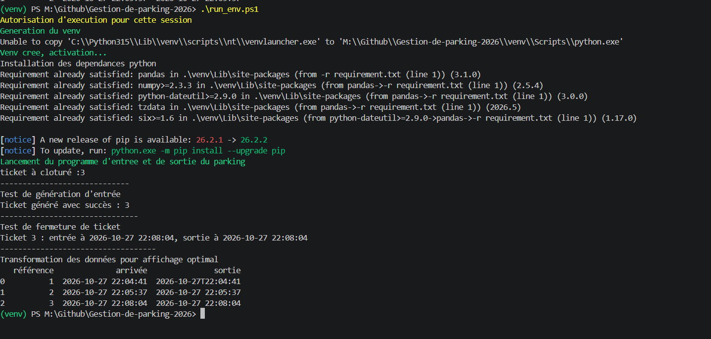
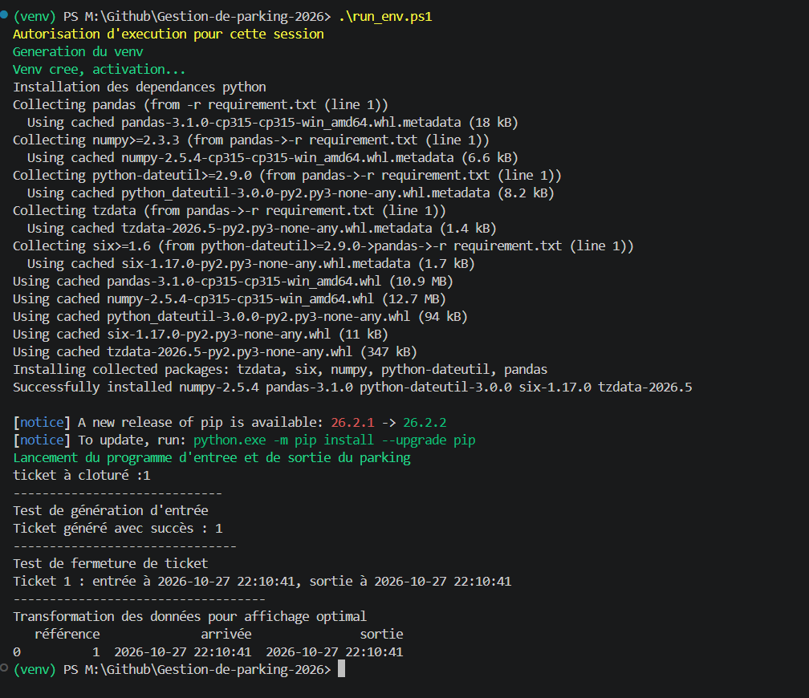

# Gestion des entrées et sorties du parking


> Utilisation de l’IA : ChatGPT (modèle Luna 6) a été utilisé pour reformuler et structurer les idées déjà présentes dans le README de base. Le contenu décrit le projet et ses fonctionnalités prévues.

## État actuel

Ce dépôt contient un prototype Python en ligne de commande pour créer et clôturer des tickets de parking. Les tickets sont enregistrés localement dans `tickets.db`, une base SQLite.

Le code est organisé dans les fichiers suivants :

- `main.py` : crée la table si nécessaire, demande un ID de ticket, crée un ticket, tente de clôturer le ticket correspondant à l'ID saisi, puis demande l'affichage des données avec Pandas.
- `enter.py` : crée un ticket et laisse SQLite attribuer son ID ainsi que l'heure d'entrée (`CURRENT_TIMESTAMP`).
- `exit.py` : recherche un ticket par son ID, vérifie qu'il existe et qu'il n'est pas déjà clôturé, puis enregistre l'heure de sortie avec `datetime.now()`.
- `Formjson.py` : lit les tickets, les transforme en JSON, puis convertit ce JSON en DataFrame Pandas pour l'afficher.
- `requirement.txt` : liste Pandas comme dépendance Python.
- `run_env.ps1` : crée un environnement virtuel, l'active, installe les dépendances et lance `main.py`.

## Données stockées

La table `tickets` contient :

| Champ | Description |
|---|---|
| `id` | Identifiant généré automatiquement ; il sert de référence du ticket |
| `heure_entree` | Date et heure d'entrée, définies par défaut par SQLite avec `CURRENT_TIMESTAMP` |
| `heure_sortie` | Date et heure de sortie ; valeur vide tant que le ticket est ouvert |

## Lancer le prototype

Depuis PowerShell, à la racine du dépôt :

```powershell
.\run_env.ps1
```

Le script installe les dépendances indiquées dans `requirement.txt` puis lance le programme. Il utilise `Set-ExecutionPolicy -Scope Process -ExecutionPolicy Bypass`, limité au processus PowerShell courant.

On peut aussi lancer le programme depuis l'environnement virtuel déjà activé :

```powershell
python .\main.py
```

> Le runner Linux est encore à tester 

## Fonctionnement actuel de `main.py`

Le programme demande d'abord l'ID du ticket à clôturer, puis crée un nouveau ticket, tente de clôturer le ticket saisi et affiche les lignes de la base dans Pandas. Il s'agit d'un enchaînement de démonstration, pas encore d'un menu d'application. Pour clôturer le ticket créé pendant cette même exécution, il faut connaître son ID avant la saisie ; le programme n'affiche pas encore clairement cet ID avant de demander lequel clôturer.

## Limites et prochaines étapes

- L'affichage Pandas dépend du bon chargement de ses bibliothèques natives. Sur la machine de développement, Windows a bloqué une DLL de Pandas avec une stratégie de contrôle d'application ; l'affichage Pandas peut donc échouer avant de présenter les données.
- Le programme ne propose pas encore de menu séparant les actions « entrée », « sortie » et « consultation ».
- Le parcours complet et les cas d'erreur n'ont pas encore été validés dans ce README.
- Aucun calcul de tarif, suivi du nombre de places, export de fichier ou interface graphique n'est présent dans les fichiers décrits ici.

# Exemple 

## Résultat attendu du script si tout est déjà installé 




## Résultat attendu si rien est installé

