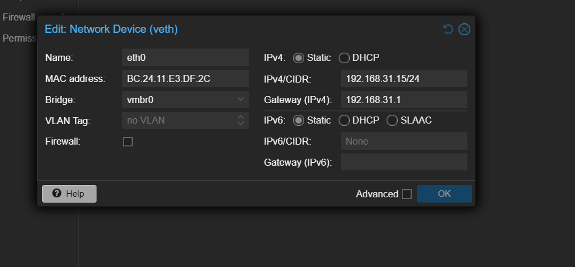
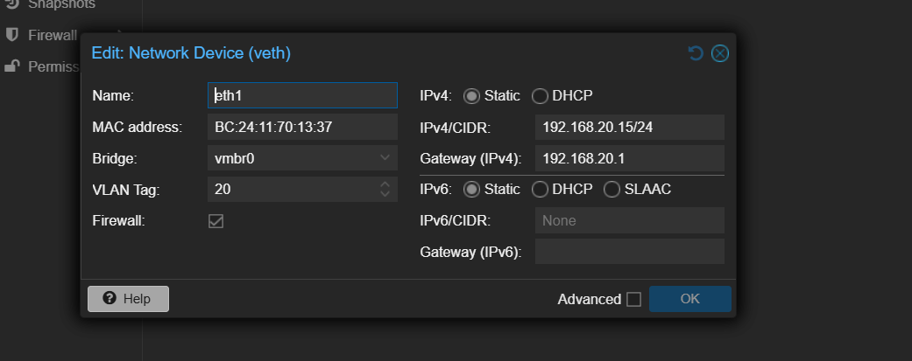

# Infrastructure réseau

## Plan d'adressage IP

**Réseau actuel :** `192.168.31.0/24`

| Équipement / Service | Adresse IP |
|---|---|
| RTR | `192.168.31.1` |
| Cisco L3 | `192.168.31.2` |
| Kubernetes | `192.168.31.3` |
| Proxmox | `192.168.31.4` |
| Home Assistant (HA) | `192.168.31.5` |
| Kubernetes-WK-01 | `192.168.31.6` |
| Bot calendrier | `192.168.31.7` |
| Uptime Kuma | `192.168.31.8` |
| Auto-calendrier | `192.168.31.9` |
| iLO 4 | `192.168.31.10` |
| Docker | `192.168.31.11` |
| SMB | `192.168.31.12` |
| Pelican Panel | `192.168.31.13` |
| Pelican Wings | `192.168.31.14` |
| Immich | `192.168.31.15` |
| CrowdSec | `192.168.31.16` |
| Ollama | `192.168.31.17` |
| pfSense | `192.168.31.24` |

## Architecture réseau

### Schéma logique

```text
         [ Passerelle : 192.168.31.1 ]
                       │ (0.0.0.0/0)
                       ▼
┌──────────────────────────────────────────────┐
│  MiWifi-L3 (IOS 16.6 | stordeur-martin.be)   │
│  SVI Vlan1 : 192.168.31.2/24                 │
│  DNS       : 192.168.31.3 | STP : rapid-pvst │
├──────────────────────────────────────────────┤
│  • Gi0/0            ─► Mgmt-vrf (no IP)      │
│  • Gi1/0/1,13,25,37 ─► NBAR Discovery        │
│  • Gi1/0/2..44      ─► Défaut                │
│  • Gi1/1/1..4       ─► Uplinks (défaut)      │
│  • Port-channel 1   ─► Trunk LACP (active)   │
│    └─ Gi1/0/45..48 (LACP fast, portfast)     │
└──────────────────────────────────────────────┘

